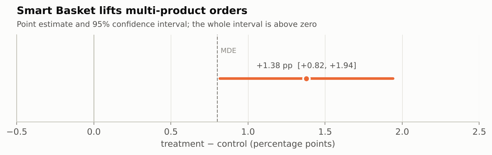
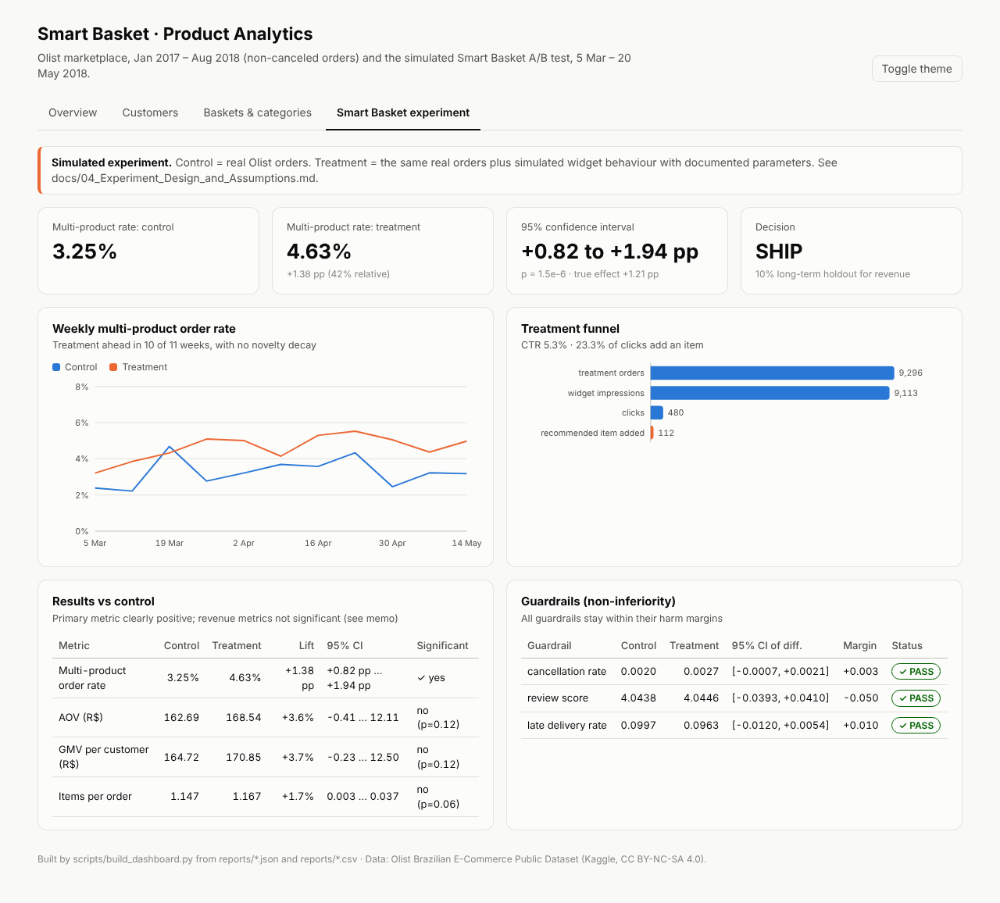
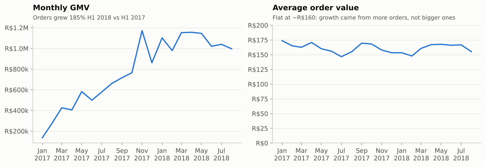
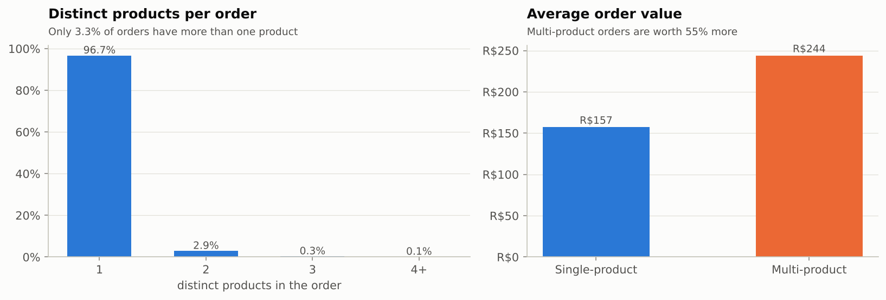
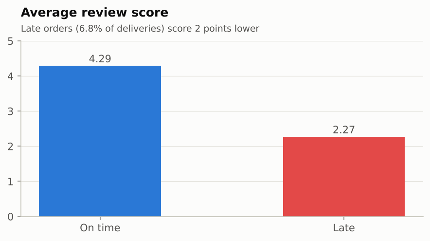
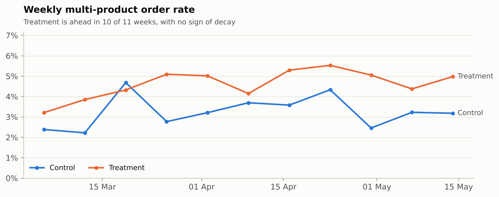

# Smart Basket: Product Analytics & A/B Testing Case Study

**Can a "frequently bought together" module at checkout grow basket size on a marketplace where 97% of orders contain a single product?**

An end-to-end product analytics project on ~100k real orders from [Olist](https://www.kaggle.com/datasets/olistbr/brazilian-ecommerce), a Brazilian e-commerce marketplace. It covers data modelling in SQL and Python, product metrics, opportunity sizing, a recommender, a pre-registered A/B test with proper statistics, and a launch decision.

   

> **Honesty note.** The data, the problem and all baseline metrics are real. The A/B test is a **simulation on real orders**: Olist never shipped this feature, so treatment behaviour (clicks, adds) comes from documented assumptions. Because the true effect is known, the analysis is also checked for whether it *recovers* that effect. [Why and how →](docs/04_Experiment_Design_and_Assumptions.md#6-simulation-assumptions)

---

## TL;DR

| | |
|---|---|
| **Problem** | Only **3.3%** of orders contain more than one product, and AOV has been flat at **~R$160** for 20 months while orders grew **185%**. |
| **Evidence of demand** | **31%** of second orders are placed **the same day** as the first: customers come back for items they could have added to the first basket. Multi-product orders are worth **55% more**. |
| **Solution** | Smart Basket v1: a category-affinity recommender (3 suggestions at checkout). Offline hit-rate@3 **36.7% vs 31.1%** for a popularity baseline. |
| **Experiment** | 11 weeks, 18,233 customers, randomised by customer, delta-method variance, A/A-validated. |
| **Result** | Multi-product order rate **3.25% → 4.63%** (+1.38 pp, +42%, 95% CI +0.82 to +1.94 pp). All guardrails pass. |
| **Decision** | **Ship to 90% with a 10% holdout.** Revenue lift is real but tiny (~R$1.25 per order) and **not detectable** in this test; the apparent +3.6% AOV lift is mostly a pre-existing chance gap. |



---

## What's in the project

| Step | Where | Highlights |
|---|---|---|
| **1. Data model** | [`sql/`](sql/) · [`notebooks/01_Data_Modeling.ipynb`](notebooks/01_Data_Modeling.ipynb) | PostgreSQL raw → analytics layers; 12 automated reconciliation checks; pandas twin matches SQL on every column for all 98,666 orders |
| **2. Product metrics** | [`notebooks/02_Product_Metrics.ipynb`](notebooks/02_Product_Metrics.ipynb) | Growth, cohorts, Pareto, basket analysis, delivery vs satisfaction, recommender evaluation, opportunity sizing |
| **3. Experiment** | [`notebooks/03_Smart_Basket_Experiment.ipynb`](notebooks/03_Smart_Basket_Experiment.ipynb) | Power analysis, 500 A/A tests, SRM & balance checks, delta method + cluster bootstrap, Holm correction, non-inferiority guardrails, novelty check, segments |
| **4. Product docs** | [`docs/`](docs/) | [PRD](docs/01_Product_Requirements.md) · [Metric definitions](docs/02_Metrics_Definition.md) · [Metrics framework](docs/03_Product_Metrics_Framework.md) · [Experiment design](docs/04_Experiment_Design_and_Assumptions.md) · [Decision memo](docs/05_Decision_Memo.md) |
| **5. Dashboard** | [`dashboard/smart_basket_dashboard.html`](dashboard/smart_basket_dashboard.html) | Self-contained interactive HTML (4 tabs, tooltips, light/dark). Download it and open it in a browser. |



---

## Key findings

**1. Growth comes from volume, not basket size.** Orders grew 185% (H1 2018 vs H1 2017) while AOV stayed at ~R$160.



**2. Baskets are tiny, and bigger baskets are worth a lot more.** 96.7% of orders contain a single product. Multi-product orders average R$244 vs R$157.



**3. Retention is the structural weakness.** Only **3.0%** of customers ever order twice, and monthly cohort retention stays below 1%. The top 10% of customers bring 38% of GMV.

**4. Late delivery destroys satisfaction.** Late orders average **2.27★ vs 4.29★**, so any feature that could split shipments needs a delivery guardrail.



**5. Category affinity is real.** Bed/bath shoppers buy home-comfort items 34× more often than chance; toys ↔ baby and bed/bath ↔ furniture & décor are strong pairs.

---

## The experiment, done properly

| Check | Result |
|---|---|
| Sample size for +0.8 pp MDE (α 0.05, power 80%) | 7,668 customers per arm → 11 weeks |
| A/A false-positive rate (500 runs) | 5.6% (expected 5%) |
| Sample-ratio mismatch | p = 0.43 (9,063 vs 9,170) |
| Control exposed to the feature | 0 impressions, 0 clicks |
| Delta method vs cluster bootstrap CI | [+0.82, +1.94] vs [+0.84, +1.94] pp |
| True simulated effect inside the CI | ✅ +1.21 pp |
| Guardrails (cancellations, reviews, late delivery) | All PASS |
| Weeks treatment ahead | 10 of 11, no novelty decay |



**The most useful lesson:** the conversion metric moved clearly, but revenue didn't move detectably. Treatment baskets were already 2.8% bigger *before* the feature did anything (pure chance). Reporting the raw +3.6% AOV gap as a feature effect would have been wrong. Hence the holdout, and a v2 focused on *value per add* (same-seller, price-aware recommendations).

---

## How to run

```bash
git clone https://github.com/Aqdas999/AI-Smart-Basket-End-to-End-Product-Analytics-Experimentation.git
cd AI-Smart-Basket-End-to-End-Product-Analytics-Experimentation
python -m venv .venv && source .venv/bin/activate     # Windows: .venv\Scripts\activate
pip install -r requirements.txt && pip install -e .

python scripts/download_data.py        # or download manually: see data/README.md
python scripts/run_pipeline.py         # builds tables, runs all notebooks, builds dashboard
pytest                                 # 15 tests, no data needed
```

**SQL version (PostgreSQL 13+):**

```bash
createdb olist
psql -d olist -f sql/01_create_schema.sql
psql -d olist -f sql/02_load_data.sql       # run from the repo root
psql -d olist -f sql/03_analytics_model.sql
psql -d olist -f sql/04_data_validation.sql # every check should say PASS
```

You can also just read the notebooks on GitHub; they're committed with outputs.

---

## Repository structure

```text
├── data/                  raw/ and processed/ (git-ignored) + README with download steps
├── sql/                   01 schema · 02 load · 03 analytics model · 04 validation (PostgreSQL)
├── notebooks/             01 data modeling · 02 product metrics · 03 A/B test (with outputs)
├── src/smart_basket/      reusable code: data_model, recommender, simulation, experiment stats, plotting
├── docs/                  PRD, metric definitions, metrics framework, experiment design, decision memo
├── dashboard/             self-contained HTML dashboard
├── reports/               metric & experiment outputs (JSON/CSV) used by the dashboard
├── images/                figures used in this README
├── scripts/               download_data · run_pipeline · build_dashboard
├── tests/                 pytest suite for the data model and statistics
├── requirements.txt · pyproject.toml · LICENSE
```

---

## Limitations

* **Simulated treatment.** The click and add rates are assumptions; a live test would measure them. Effects on checkout completion and real guardrail harm (split shipments) can't be simulated from this data.
* **Category-level recommendations.** v1 recommends categories, not specific products. It's enough to test demand, not production quality.
* **Historical data (2016–2018)** from one marketplace. Absolute numbers won't transfer to other platforms; the method does.
* **No session or funnel data** in Olist, so the experiment can only measure order-level outcomes.

## Skills demonstrated

Product sense (problem framing, PRD, metric trees, decision memo) · SQL data modelling & validation (PostgreSQL, CTEs, window functions) · Python (pandas, NumPy, SciPy, matplotlib) · experiment design (power analysis, randomisation, pre-registration) · experiment analysis (delta method, bootstrap, SRM, A/A, multiple-testing correction, non-inferiority) · recommender evaluation · data visualisation & dashboarding · testing and reproducible project structure.

---

*Data: Olist Brazilian E-Commerce Public Dataset, CC BY-NC-SA 4.0. Code: MIT.*
